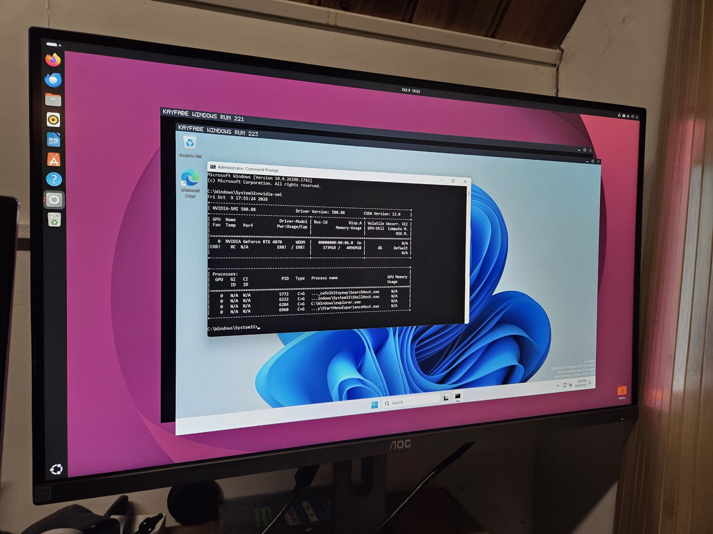

# kayfabe

**Share a consumer NVIDIA GPU with virtual machines that run the stock NVIDIA driver, while the host keeps using it.**

Kayfabe is a QEMU device (`kf3-gpu`) that shows a guest an emulated NVIDIA GPU plus a faked GSP. The guest loads the
real, unmodified NVIDIA driver (Windows or Linux) against it. Kayfabe reads what that driver asks for (GSP RPCs, page
tables, doorbells) and has the real host GPU do the work, from an **unprivileged** host process that talks to the host
driver as an ordinary RM client. It is written in Rust.

**STATUS: LIVE, 2026-10-15.** Research stage: no installer, no stable interface, not security-audited. Everything below
names its evidence; what is measured is kept apart from what is planned. Long form: [`docs/STATUS_DETAIL.md`](docs/STATUS_DETAIL.md);
resume point and open decisions: [`docs/STATUS_AND_HANDOFF.md`](docs/STATUS_AND_HANDOFF.md).



*Windows 11 inside a window on the host's Linux desktop, `nvidia-smi` listing the RTX 4070 under the stock 580.88 driver
(an early run, 2026-10-09; the current state is in the tables below).*

## Why it matters

| | host keeps the GPU | guest driver | needs | guest is trusted |
|---|---|---|---|---|
| VFIO passthrough | no, one VM owns it | stock | any GPU | n/a |
| NVIDIA vGPU | yes | vendor vGPU guest driver | data-centre GPUs, SR-IOV, a licence | n/a |
| **kayfabe** | **yes** | **stock, unmodified** | a consumer GPU (Turing to Blackwell), open host driver | **no: hostile guest** |

- **Nothing is patched.** No host or guest driver, kernel or userspace, is patched; the guest uses NVIDIA's own installer
  and the usual virtio drivers. A stock host needs no kernel patches; an optional patched tier exists
  ([`V3_HOST_PATCH_LIST.md`](docs/design/V3_HOST_PATCH_LIST.md), design-only).
- **Hostile-guest isolation.** Guest root and guest userspace are both untrusted. Every host action is *authored* by kayfabe from
  a small set of unprivileged RM verbs, never forwarded from guest bytes ([`V3_SECURITY_MODEL.md`](docs/design/V3_SECURITY_MODEL.md)).
- **The guest OS stops being a constraint.** You cannot ask Windows to load your kernel module, but it loads NVIDIA's.
- **Guest VRAM is preallocated** like a real vGPU (for example 4 GiB of the 12 GiB card, `fb-mb=4096`); the rest stays free for the host.
- Related, public approaches: VFIO passthrough, NVIDIA vGPU, Intel GVT-g, gVisor's `nvproxy`, and the author's earlier
  [nvkvm-pv](https://github.com/reindertpelsma/nvkvm-pv) (a guest module that forwards the driver's API). No performance comparison with
  any of them is made here, because none has been measured at this revision.

## What runs today (measured)

Kayfabe revision `eb9f2aa3` (Windows) and `559db30c`..`1d845d50` (Linux); host RTX 4070 (AD104), host driver 595.91.07. Unless noted the
Windows runs use the production flag profile (no tracing). Every row names its evidence.

**Windows 11 guest** (stock driver 580.88; matrix [`traces/win11_userring_20261014/matrix-eb9f2aa3-20261014-2321.md`](traces/win11_userring_20261014/matrix-eb9f2aa3-20261014-2321.md);
pass = the app's own completion, 0 host Xid, 0 GSP resets, 0 guest `nvlddmkm` 4101 events):

| app | result |
|---|---|
| Minecraft Java | in a world, 6 minutes walking, frames moving |
| Unigine Heaven, Direct3D 11 | 18.0 fps windowed, 21.2 fps fullscreen |
| Unigine Heaven, OpenGL | passes: windowed 271 fps; fullscreen 29.9 fps (see the limits table) |
| GravityMark | Direct3D 12 134.2 fps, Vulkan 95.9 fps |
| Edge + YouTube Big Buck Bunny 4K60, hardware decode (NVDEC) | 10:34 played to the end, 0 Xid, 0 TDR ([`traces/win11_userring_20261014/README.md`](traces/win11_userring_20261014/README.md), run 1 at `a8424ae2`) |

Reported by the owner, **no evidence committed yet**: SolidWorks Design 2026 (academic) installs, renders and passes its own
Performance Test (graphics 39.2 s, overall 79.6 s, from a photo; launcher: `scripts/bench/windows/kfagent_ogl/launch-2990-solidworks.sh`);
Blender 5.2.2 LTS renders its viewport; YouTube 4K60 watched for 30 minutes.

**Linux guest** (stock driver; `docs/design/V3_USER_RING_EVENT_LOOP_20261014.md` §8, `traces/linux_s3_resume_20261014/fixed/`,
`traces/linux_planes_oracle_20261014/`):

| what | result |
|---|---|
| fast suite (30 raw-client arms, one boot each) | 30/30, also with the user-ring relay forced on |
| GPU gates (`kf-gate1`..`9`, real GPU, no QEMU) | 9/9, plus gate 10 |
| desktop (Cinnamon/Xorg, broker) | glxgears ~60 FPS, 0 flip timeouts, 0 host Xid (`traces/linux_planes_oracle_20261014/validation-edf2759d/`) |
| display planes (overlay, YUV) | rgb / nv12 / p010 / yuyv pass on the console ([`V3_DISPLAY_PLANES_ORACLE.md`](docs/design/V3_DISPLAY_PLANES_ORACLE.md)) |
| ACPI S3 suspend/resume of the desktop guest | 3 of 3 cycles: ssh, `nvidia-smi`, glxgears, 0 Xid ([`V3_S3_RESUME.md`](docs/design/V3_S3_RESUME.md)) |
| CUDA and applications (earlier, 2026-10-08, nested vast box, RTX 3060) | 61/65 apps + 6/6 probes pass in the guest; the four failures need UVM demand paging ([`V3_APP_MATRIX.md`](docs/design/V3_APP_MATRIX.md), `traces/merge_bar_20261008/`) |
| CUDA speed (same box, nested) | `cup8bench`: 784 GFLOPS guest vs 786 host; llama-bench 1.5B Q4: prompt 0.998x, decode 0.877x of host; eager PyTorch decode 0.29x (every launch traps) ([`V3_LINUX_PERF_BASELINE_6692e621.md`](docs/design/V3_LINUX_PERF_BASELINE_6692e621.md)) |

### Linux guest performance (measured, older revisions, nested box)

How close the guest gets to the host on the same GPU. These are the numbers that exist; they were taken on a rented RTX 3060 that is
itself a KVM guest (a VM exit costs 10 to 40 times bare metal, so they are conservative for the trapping parts) at revisions
`b5c9f717`, `9d82f259` and `ca7a5006`, not at the current tree. Sources: [`V3_LINUX_PERF_BASELINE_6692e621.md`](docs/design/V3_LINUX_PERF_BASELINE_6692e621.md) §2,
`traces/merge_bar_20261008/`, `traces/v3_candidates/cand2_20261004/`.

| workload | host | guest | guest / host |
|---|---|---|---|
| matrix multiply (`cup8bench`, N=2048) | 786 GFLOPS | 784 GFLOPS | 0.997 |
| llama-bench Qwen2.5-1.5B Q4_K_M, prompt processing | | | 0.998 |
| llama-bench, token generation | | | 0.877 |
| device-to-device copy (`bandwidthTest`, 32 MB) | 327 GB/s | 322 GB/s | 0.98 |
| host-to-device / device-to-host copy (pinned, 32 MB) | 7.8 / 8.0 GB/s | 9.7 / 10.3 GB/s | not slower |
| app matrix (65 apps, 61 pass in the guest), sum of per-app seconds | 1075 s | 1193 s | 1.11x the time |
| NVENC 1080p H.264 (RTX 3070 box, older revision `d06833f0`) | 198 fps | 142 fps | 0.72 |
| eager PyTorch decode (Qwen2-0.5B) | 42.2 tok/s | 12.2 tok/s | 0.29 |
| CUDA context create | 0.13 s | 1.0 s | 7.7x the time |

Reading it: large kernels and copies run at host speed, because the work is submitted once and runs on the real GPU. Anything that
launches many tiny kernels (eager PyTorch) or creates contexts pays for every doorbell and control call, which is the cost the
doorbell and relay work targets. **Not measured yet:** the same set on the home RTX 4070 without nesting, at the current revision
(`scripts/bench/perf_compare.sh` is the harness; the baseline doc says the AFTER run has not been done). Treat these as a floor, not as
a claim about the current tree.

GPU-free tests at this tree: **3138 passed, 0 failed, 12 ignored** across the 22 `kf-*` crates (`cargo test --release`, 2026-10-15).

## What does not work, or is not finished

| item | state |
|---|---|
| Windows S3 sleep/wake | does not survive the wake, 0 clean cycles ([`traces/win11_s3_20261014/README.md`](traces/win11_s3_20261014/README.md)); the GSP side holds. Sleep is disabled in the Windows test image |
| Edge long runs | a reset (TDR, `RESET_CHANNEL` refused, no host Xid) 7 to 16 minutes into Edge playback ([matrix](traces/win11_userring_20261014/matrix-eb9f2aa3-20261014-2321.md): FAIL at 7.3 min) |
| Windows idle for 30 minutes | not run |
| Heaven OpenGL fullscreen | 29.9 fps, down from 160.1 fps earlier: the overlay reads exactly 30 (every other vblank); the guest now picks immediate flips, cause inferred, not investigated ([`traces/win11_userring_20261014/README.md`](traces/win11_userring_20261014/README.md) §4d) |
| Text I-beam cursor | not drawn (fix on an open branch, not in this tree) |
| Other dies under Windows | display needs the real caps page, which is derived for none: AD106/AD103 work with a page captured on AD104; GA104 has the GPU but no display; Turing refuses `display=on`; GB206 hits Code 43 (rented-box results, open branch `claude/die-sweep-20261014b`) |
| S3 resume on FSP-booted families (Hopper, Blackwell) | not built ([`V3_S3_RESUME.md`](docs/design/V3_S3_RESUME.md)) |
| Pre-v3 `kayfabe-*` crates | frozen; kept only so the 30-arm raw client (`kayfabe-rm-ladder`) builds |
| Security | not audited; no public binary should ship before the stage-2 blockers close (`docs/OWNER_RULINGS.md` §P). Open items include the graphics-context hold timeout, BAR1 and mapping quotas, twin VRAM accounting and scrubbing between tenants ([`V3_SECURITY_MODEL.md`](docs/design/V3_SECURITY_MODEL.md) §9, [`V3_FEATURE_GAPS.md`](docs/design/V3_FEATURE_GAPS.md)) |
| Performance on Windows | only the numbers above; no VFIO or bare-metal comparison is measured at this revision |

## Supported hardware and drivers

What was actually run. "Measured" means a result with a revision and an evidence directory; the per-die facts are derived from the host at
runtime wherever the host can answer (the one captured per-die table still in this tree, the display caps page taken from the AD104, is listed above as a limit), with family rows maintained by hand ([`V3_CONSTANT_STRATEGY.md`](docs/design/V3_CONSTANT_STRATEGY.md)).

| die | Linux guest | Windows 11 guest |
|---|---|---|
| AD104 (RTX 4070, owner host) | everything in the tables above | everything in the tables above |
| GA106 (RTX 3060, rented box, nested) | merge bar: 2419 tests, gates 9/9, fast suite 30/30, apps 61/65 (`traces/merge_bar_20261008/`) | not run |
| TU116, AD104 (RTX 4000 Ada), GB205 | merge bar and CUDA ladder at 2026-09-30 ([`docs/STATUS_DETAIL.md`](docs/STATUS_DETAIL.md) §0) | not run |
| GA104, GA102, AD106, GB203, GB206 | passed at earlier revisions ([`docs/STATUS_DETAIL.md`](docs/STATUS_DETAIL.md) §0); GB206 needs host 580.159.04 | see limits: AD106/AD103 desktop, GA104 and TU106 GPU only, GB206 Code 43 |
| Hopper, GA100, GB10x | derived from the open driver's source only; GA100 and GB10B are refused by name | none |

Host: Linux x86_64 with KVM, the NVIDIA **open** kernel module (580.159.04 on the rented boxes, 595.91.07 on the owner host; matrix in
[`V3_DRIVER_MATRIX.md`](docs/design/V3_DRIVER_MATRIX.md)), QEMU **10.2.4** with the `qemu/hw/misc/kf3` overlay, Rust **1.99.0** (pinned in `rust-toolchain.toml`).
Guest drivers run: Windows 580.88; Linux 580.159.04 and 595.91.07 (the host's own `.run`). Guest RAM must be a shared memfd. Hardware
results come mostly from vast.ai boxes that are themselves VMs (a VM exit costs 10 to 40 times bare metal), so ratios are per box.

## Build and run

GPU-free (any Linux x86_64 box with the pinned toolchain):

```sh
rustup target add x86_64-unknown-linux-musl x86_64-unknown-uefi   # listed in rust-toolchain.toml
cargo build --workspace --release
cargo test --release $(ls crates | grep '^kf-' | sed 's/^/-p /')
```

On a box with a GPU, in this order (details: [`scripts/bench/box/README.md`](scripts/bench/box/README.md); needs your own QEMU 10.2.4 source tree and guest image):

```sh
bash scripts/bench/v3_gates.sh                     # kf-gate1..9 on the real GPU, no QEMU: expect 9/9
bash scripts/bench/build_kf3.sh <qemu-10.2.4-src>  # installs <bench>/kf3-bins/<rev>/qemu-system-x86_64
cargo build --release -p kayfabe-rm-ladder --bin kayfabe-rm-ladder
bash scripts/fastguest/build_fast_guest.sh <guest.qcow2> <bench>/fastguest
KF_DEVICE=kf3 bash scripts/fastguest/fast_suite.sh <tag> 180   # 30 arms: expect 30/30
```

- **Linux desktop guest:** `scripts/bench/display/` (`desktop_smoke.sh`, `desktop_s3.sh`, `planes_oracle.sh`, `broker_lane.sh`).
- **Windows 11 guest:** `scripts/bench/windows/win_vm.sh install | run | nv-install | check` ([`README`](scripts/bench/windows/README.md)): an unattended
  install from Microsoft's evaluation media, then the NVIDIA driver with GSP forced on. `regress_matrix.sh` runs the app matrix on a VM that you have
  already set up. The long-running owner VM, its image and its app media are not in the repository ([`V3_NOT_IN_GIT.md`](docs/design/V3_NOT_IN_GIT.md)).
- **Renting a test box:** `scripts/bench/box/provision_full.sh` (untrusted boxes, no secrets, tear down by your own ids).

There is no installer and no packaged binary.

## Architecture

One process: QEMU with the kayfabe core linked in. The guest's BAR0 writes (and only those) trap; privileged writes go into one
ordered ring drained by one thread that serves the faked GSP and the emulated RM, and doorbells set bits that worker threads service.
Guest channels become host *twin* channels that run the guest's pushbuffers on the real engine (Passthrough), are rewritten
onto kayfabe's own window (Translated), or run in the VMM when no GPU work stands behind them (Emulated). Guest memory is one
store; a CUDA walk kernel diffs the guest's live page tables against what the host confirmed it mapped.
Start at [`ARCHITECTURE.md`](ARCHITECTURE.md) (one page), then [`docs/design/THE_ARCHITECTURE_v3.md`](docs/design/THE_ARCHITECTURE_v3.md),
[`THE_V3_PLAN.md`](docs/design/THE_V3_PLAN.md), and the per-subsystem `docs/design/V3_*.md`.

| path | what |
|---|---|
| `crates/kf-*` | v3, the product (trap path, faked GSP, emulated RM, chip model, host verbs, store, channels, display, the QEMU device's Rust half, the gates) |
| `crates/kayfabe-*` | the pre-v3 tree, frozen |
| `qemu/hw/misc/kf3/`, `cuda/walk/`, `firmware/kf-gop/` | the C QOM device, the walk kernel (`.cu` + PTX), the boot-display UEFI driver |
| `scripts/bench/`, `scripts/fastguest/`, `tools/` | provisioning, gates, lanes, derivation tools |
| `traces/` | evidence, one directory per result |
| `third_party/`, `archive/` | pinned reference sources (not built); the frozen C prototype |

## Design principles

- **Hostile guest.** Guest userspace and guest root are both untrusted; a guest-reachable unbounded read or emit is a security bug.
- **Derive, never capture.** Per-die facts come from the host through unprivileged controls; register offsets and class sets are generated
  from NVIDIA's open driver headers. A captured per-die table is the defect v3 exists to end. All GPU families are first-class.
- **Only BAR0 writes trap, and nothing blocks on a vCPU** or under a lock a vCPU takes.
- **No CPU executor for GPU work,** and no forged completion for work that reached the GPU.
- **Behaviour is hardwired; flags are for measurement.** A flag that is needed to boot is a defect; measurement flags are never required.
- **Unsafe code** only in `kf-linux-raw`, `kf-qemu` and `kf-cuda`, and only in files named `*_unsafe.rs`.
- **Doc hygiene.** Every design doc opens with a dated STATUS line; a correction is folded in above the text it corrects.

The owner's binding decisions are in [`docs/OWNER_RULINGS.md`](docs/OWNER_RULINGS.md); the constraints in [`THE_CONSTRAINTS.md`](docs/design/THE_CONSTRAINTS.md).

## How it is tested

1. **GPU-free:** `cargo test` for the `kf-*` crates (3138 tests above), including oracles generated from the open driver headers.
2. **Gates on a real GPU, no QEMU:** `scripts/bench/v3_gates.sh` (`kf-gate1`..`9`, `gate10`; every channel born is a USER channel).
3. **Fast suite:** 30 raw-client arms, one boot each, a hard budget each; bare metal is the baseline, and if bare metal passes and the guest fails the defect is kayfabe's.
4. **Lanes:** CUDA ladder, app matrix, LLM parity, graphics, video, Linux desktop, and `scripts/bench/windows/regress_matrix.sh` for Windows.

A bench claim carries its source revision: `build_kf3.sh` installs each revision's binary under `kf3-bins/<rev>/` and the lanes run that binary. GitHub CI
(`scripts/ci_gates.sh` runs its gate steps locally) is opportunistic and is not the definition of green.

## Licence, provenance, security

Dual-licensed **Apache-2.0 OR GPL-2.0-or-later** (SPDX headers; texts in [`LICENSE-APACHE`](LICENSE-APACHE) and [`LICENSE-GPL`](LICENSE-GPL), grant and
exceptions in [`LICENSE`](LICENSE)). Exceptions: the `third_party/` submodules, files with their own notice, third-party data inside recorded traces, and
the files derived from gVisor's nvproxy, which stay Apache-2.0 only until re-derived; because the kf3 device links one of them, a QEMU binary built from this
tree is not yet distributable under the GPL.

Where constants and interfaces come from, and the limits on reverse engineering, are in [`docs/design/V3_PROVENANCE.md`](docs/design/V3_PROVENANCE.md) (a policy; draft,
pending legal review).

Security: kayfabe has not been audited and ships no public binary. To report a suspected vulnerability, contact the repository owner privately through GitHub and do not
post details in a public issue. Rules for contributors (including agents) are in [`AGENTS.md`](AGENTS.md).

## More

[`ARCHITECTURE.md`](ARCHITECTURE.md) | [`docs/STATUS_DETAIL.md`](docs/STATUS_DETAIL.md) | [`docs/STATUS_AND_HANDOFF.md`](docs/STATUS_AND_HANDOFF.md) |
[`docs/FAQ.md`](docs/FAQ.md) | [`docs/PRODUCT_POSITIONING.md`](docs/PRODUCT_POSITIONING.md) | [`docs/PROJECT_HISTORY.md`](docs/PROJECT_HISTORY.md) (status history, Mode 1 vs Mode 2,
the archived C prototype in [`archive/nvkvm/`](archive/README.md)). `docs/whitepaper/` describes the pre-v3 architecture and is kept as a record.
