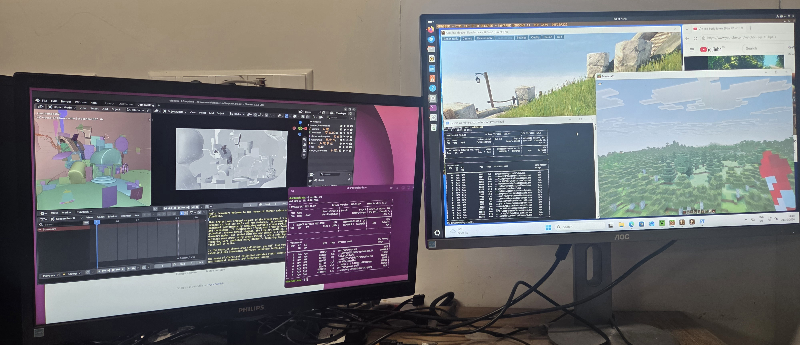

# kayfabe

**STATUS: RESEARCH, 2026-11-08.** No installer, public binary or stable interface yet; no security audit has been completed (maintainer statements, [manual checklist MC-11](docs/RELEASE_CLAIMS.md#mc-11-project-statements)).

**Share an NVIDIA GPU with virtual machines that run the stock NVIDIA driver, while the host keeps using it.**

Kayfabe is a QEMU device that presents a virtual NVIDIA GPU to a Windows or Linux guest. The real GPU executes the work through the host's NVIDIA driver. It is written in Rust, with a C QEMU device ([architecture](ARCHITECTURE.md)).

**Not finished:** Windows sleep/wake and Edge playback stability. Earlier Windows records include failed sleep/wake and playback resets; short passing probes do not settle either ([sleep/wake](traces/win11_s3_20261014/README.md), [Windows apps](traces/win11_userring_20261014/matrix-eb9f2aa3-20261014-2321.md)).

By design, guests are hostile: kayfabe authors unprivileged host operations and confines GPU work to the guest's mappings. This is a design boundary, not a security certification ([how it is isolated](docs/howto/security.md#what-the-isolation-is-made-of)).

Site: [kayfabe.dev](https://kayfabe.dev/) | [manual](https://kayfabe.dev/docs/) | [build instructions](docs/howto/building.md) | [FAQ](docs/FAQ.md) | [goals and plans](docs/howto/goals.md) | [what works today](#what-runs-today)

<i>Recorded desktop session, 2026-10-21, revision `89fc8a222`. The photo is not an application stability test ([caption checklist MC-1](docs/RELEASE_CLAIMS.md#mc-1-screenshot-and-caption)).</i>

## Why it is interesting

The host and multiple guests can use one GPU together: two runs on one RTX 4090 recorded correct results from a host CUDA loop, a Linux guest and a Windows guest at revision `3aa2a75a6`, 2026-11-05 ([record](traces/trio_vast_20261105/README.md)).

That experiment included the suite's fault arms, with no GPU resets in those runs; it did not test a hostile long-running kernel or establish general fault containment ([limits](traces/trio_vast_20261105/README.md)).

## What runs today

These are recorded results at named revisions, not qualification of the current tree.

| Windows gate | Revision and date | Evidence |
|---|---|---|
| TU106, TU116: PASS | `0c515b3b3`, 2026-11-04 | [Turing](traces/die_coverage_20261104/turing/README.md) |
| GA104, GA106: PASS | `0c515b3b3`, 2026-11-04 | [Ampere](traces/die_coverage_20261104/ampere/README.md) |
| GA102: PASS twice | `006d845a`, 2026-11-03 | [RTX 3090](traces/ampere_hw_20261103/README.md) |
| AD102, AD104: PASS | `0c515b3b3`, 2026-11-04 | [Ada](traces/die_coverage_20261104/ada/README.md) |
| GB205, GB206: PASS; GB202: intermittent (FAIL, then two PASS on the same box) | `0c515b3b3`, 2026-11-04 | [Blackwell](traces/die_coverage_20261104/blackwell/README.md) |

The Windows gate checks the stock 580.88 driver, CUDA and D3D11 probes before and after an idle period, reset counters and a same-box host reference. LiveKernelEvent 193 is reported as `known_live_dumps_193`; it gates above a recorded per-die maximum or with explicit strict mode ([gate contract](docs/design/V3_WINDOWS_GATE.md), [setup](docs/WINDOWS_GUEST_SETUP.md)).

**Linux applications, RTX 4090:** 70/70 runnable apps passed on the host and 66/70 in the guest, revision `144557e43`, 2026-11-07. Passing apps met their own correctness predicates; only the three digest-producing apps have matching host/guest digests in that run ([matrix and limits](traces/apps_linux_20261107/README.md)).

**Unsupported for now:** UVM demand paging, including `UnifiedMemoryStreams`, `UnifiedMemoryPerf`, `conjugateGradientUM`, `attach_verify` and the Windows counterpart `managed_t`. Reports list them as `unsupported (UVM)`; the owner's merge hold requires the per-fault GR hold to be measured and bounded ([ruling §E](docs/OWNER_RULINGS.md#e-uvm-demand-paging-2026-09-26), [FAQ](docs/FAQ.md#does-cuda-give-the-same-results-as-the-host)).

**Manual: needs real display.** All eight `overlay_yuv_*` entries, including the probe and soak, stay visible in reports and are outside the Vast gate. The native probe returned SETUP/refused (code 5) on a Vast simulated display: no DIRECT overlay, no scenario frames; no real-monitor native record is committed ([native record](traces/windows_overlay_native_20261010/README.md), [evidence template](docs/RELEASE_CLAIMS.md#mc-14-windows-yuv-overlays-on-a-real-display)).

**Stage code, not deployment:** the Windows apps and SPECviewperf stages exist and remain disabled by default pending their first Worker run; neither new stage is deployed ([Windows apps](docs/design/V3_WINDOWS_APPS_GATE.md), [SPEC stage](docs/design/V3_SPEC_GATE.md)).

Per-die evidence and its historical limits: [family coverage](docs/design/V3_FAMILY_COVERAGE.md). Manual claims for Minecraft editions/multiplayer, SolidWorks, OBS and Office await their [evidence checklists](docs/RELEASE_CLAIMS.md#manual-checklists); they are not compatibility promises here.

## Trying it

For development, start with [the handoff](docs/STATUS_AND_HANDOFF.md), [build instructions](docs/howto/building.md) and [Windows bench instructions](scripts/bench/windows/README.md). The stock path uses vendor drivers; optional bring-up patches and UVM research do not establish supported UVM ([requirements](docs/howto/requirements.md)).

Documented commands: `cargo build --workspace --release` and `KAYFABE_NO_KVM=1 cargo test --workspace --locked --no-fail-fast -j2`. A [cold-clone run](traces/release_checks_20261107/README.md) at `fe0cd47e3` built successfully but recorded 14 test failures.

## Learn more

[Architecture](ARCHITECTURE.md) | [design](docs/design/THE_ARCHITECTURE_v3.md) | [owner rulings](docs/OWNER_RULINGS.md) | [documentation map](docs/README.md) | [contributor rules](AGENTS.md) | [release claims and manual evidence templates](docs/RELEASE_CLAIMS.md)

Dual-licensed **Apache-2.0 OR GPL-2.0-or-later**; [LICENSE](LICENSE) lists exceptions, including the restriction on distributing a QEMU binary from this tree under the GPL.

[Provenance policy](docs/design/V3_PROVENANCE.md) | [Security and private reporting](docs/howto/security.md)
