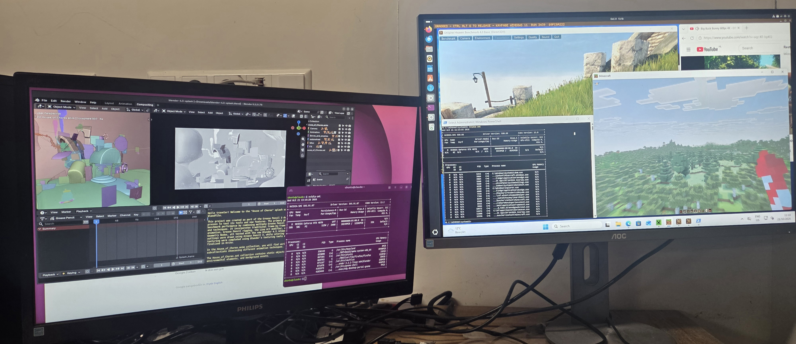

# kayfabe

**STATUS: RESEARCH, 2026-10-21.** One maintainer, no installer (you build it from source), no public binary, no stable interface, no security audit yet. Windows is not stable: sleep/wake fails and some apps make the GPU driver reset. Master is the current working version (relay fix `89fc8a222`, 2026-10-21); newer experiments, the Blackwell display work and further performance work live on branches.

**Share an NVIDIA GPU with virtual machines that run the stock NVIDIA driver, while the host keeps using it.**

With kayfabe, Windows or Linux in a virtual machine uses NVIDIA's own driver and your real graphics card, for games, video and CUDA, while your computer keeps using the same card. No special hardware, no licence server, and nothing in your NVIDIA driver is patched. Kayfabe is a QEMU device that presents a virtual NVIDIA GPU to the VM; the real work runs on your real card. The VM reaches your GPU the way any normal program does, through your NVIDIA driver, so the driver's usual separation between programs applies. That is the design, and it has not been audited ([how it is isolated](docs/howto/security.md#what-the-isolation-is-made-of)). Written in Rust.

Site: [kayfabe.dev](https://kayfabe.dev/) | [manual](https://kayfabe.dev/docs/) | [FAQ](docs/FAQ.md) | [goals and plans](docs/howto/goals.md) | [what works today](#what-runs-today)

<i>Windows 11 on kayfabe: desktop and nvidia-smi under the stock 580.88 driver. On Windows, displayed using nvkvm broker on an Ubuntu desktop: Minecraft Bedrock/Windows only edition, Unigine Heaven benchmark, nvidia-smi in powershell, Big Buck Bunny Blender on Youtube in Edge. On Linux left screen: Blender, nvidia-smi showing a single gpu being used for all the apps in the screenshots and Firefox in background (host keeps gpu). There is no PCIe/DMA copy of frames for this windows desktop (i.e both screens are directly plugged in the GPU).</i>

## Why it is interesting

| | host keeps the GPU | safe for untrusted guests | guest driver | needs |
|---|---|---|---|---|
| VFIO passthrough | no, one VM owns it | yes | stock | any GPU |
| NVIDIA vGPU | no, VMs share it, the host does not | yes | vendor vGPU driver | data-centre GPU, licence |
| API forwarding ([nvkvm-pv](https://github.com/reindertpelsma/nvkvm-pv) / virtio-nvgpu) | yes | possible, but fragile for multi-tenant VMs | a custom guest module | any NVIDIA GPU |
| **kayfabe** | **yes** | **yes, by design (not yet audited)** | **stock, unmodified** | any NVIDIA GPU is the goal; tested on consumer cards (Turing to Blackwell); the open NVIDIA host driver |

- **Nothing is patched.** No host or guest driver or kernel is modified; the guest uses NVIDIA's own installer.
- **The guest is treated as hostile.** Every host action is authored by kayfabe from a few unprivileged verbs, never forwarded from guest bytes.
- **Windows speed is being benchmarked again on current master.** Windows runs real 3D applications (see below); the results will be posted here.

- **Linux guests run CUDA at host speed** for large work (rented RTX 3060 box that is itself a VM, older revisions; [details](docs/design/V3_LINUX_PERF_BASELINE_6692e621.md)):

  | workload | host | guest | guest / host |
  |---|---|---|---|
  | matrix multiply (N=2048) | 786 GFLOPS | 784 GFLOPS | 0.997 |
  | llama.cpp Qwen2.5-1.5B Q4, prompt processing | | | 0.998 |
  | llama.cpp, token generation | | | 0.877 |
  | device-to-device copy (32 MB) | 327 GB/s | 322 GB/s | 0.98 |
  | app matrix, 65 apps (sum of per-app seconds) | 1075 s | 1193 s | 61 pass, 1.11x the time |

  The cost is in many small launches: eager PyTorch decoding runs at 0.29 of host speed, creating a CUDA context takes about 8 times longer, and NVENC 1080p
  reached 0.72 (older box). The same set on the home RTX 4070 without nesting has not been run yet.

## What runs today

**Windows 11 guest** (Windows 11 Pro and Enterprise LTSC; NVIDIA's stock 580.88 driver and installer; a few registry settings are required, listed in [`docs/WINDOWS_GUEST_SETUP.md`](docs/WINDOWS_GUEST_SETUP.md); [matrix](traces/win11_userring_20261014/matrix-eb9f2aa3-20261014-2321.md) on Windows 11 Pro, revision `eb9f2aa3`; pass = the app's own completion, no host Xid, no GPU reset):

| app | result |
|---|---|
| Minecraft Java and Bedrock | in a world, multiplayer works fine; no freezes in the latest session (revision `89fc8a222`, 2026-10-21, 15+ minutes beside Unigine Heaven). Earlier revisions froze apps for seconds when several ran at once; the relay handoff fixes the measured cause (Linux: 0 of 26 stalled pairs against 3 of 12 before) |
| Unigine Heaven, Direct3D 9, Direct3D 11 and OpenGL | pass |
| GravityMark | Direct3D 12 and Vulkan pass (134 and 96 fps at that revision, need a new benchmark to confirm fps with performance fixes) |
| Edge + YouTube 4K60, hardware decode (NVDEC) | 10:34 played to the end |
| CUDA in the guest | works: `nvidia-smi` shows CUDA 13.0; matrix multiply (N=2048) about 1.9 TFLOPS; Blender 5.2 Cycles renders with CUDA and OptiX (OptiX 5.3 s against 3.4 s native, 1.57x slower; measured 2026-10-15 on branch `claude/perf-win-20261015`) |
| SolidWorks 2026 (student edition) | installs, renders, passes its builtin Performance Test; loads and renders sample projects fine; evidence not yet committed |
| Blender on Windows | Renders sample files properly, needs more testing |
| 3DMark demo on Steam | Steel Nomad (full, DX12) scores 2050 to 2991, i.e. 20 to 30 fps, depending on revision and what else is running (latest run 2227 with Minecraft, OBS and a video playing at the same time); native VFIO on the same GPU scores about 3800 to 3960 (38 to 40 fps). Result files are not committed yet |
| OBS Studio on Windows | Recorded the desktop, Unigine Heaven and 3DMark Steel Nomad successfully, OBS reports NVENC was used (OBS log: `obs_nvenc_h264_tex`; the host GPU's encoder showed 21% load attributed to the VM process). MP4 video playback has no issues that I noticed. Result is not commited yet |
| Office 365 | No issues so far |

Minecraft, Blender, Office, Edge, Steam, 3DMark, Unigine and SolidWorks run unmodified, from the vendors' official, complete installers (nothing stripped down or patched). All apps except Office are confirmed to be using the NVIDIA GPU, not software rendering: Steel Nomad and the SolidWorks performance test report it, Unigine and Minecraft show up in the guest's `nvidia-smi`, Minecraft Java's F3 screen names the RTX 4070, and Blender has it selected in its settings.

**Linux guest** (NVIDIA's stock driver, unmodified, nothing to set): the 30-arm suite passes (also with the relay forced on); gates 9/9 on the real GPU; a desktop with display planes (overlay, YUV)
and 3 of 3 suspend/resume cycles; **61 of 65 CUDA apps** (CUDA samples, PyTorch, Hugging Face generation, llama.cpp), 6 of 6 stream probes and 100 processes in one boot, with
outputs equal to bare metal (earlier run, rented RTX 3060; [matrix](docs/design/V3_APP_MATRIX.md)). The 4 failures use unified (UVM) memory paging and fail loudly.

**GPUs:** all of the above on the owner's RTX 4070 (AD104). Linux guests also passed on GA106 (RTX 3060), TU116, AD104 (RTX 4000 Ada), GB205 and, more recently, AD102
(Linux guest driver 590); Windows desktops run on AD106 and AD103 with a borrowed display page, GA104 only has the GPU, and GB206 under Windows is still open
(Code 43). Per-die table: [`docs/STATUS_DETAIL.md`](docs/STATUS_DETAIL.md).

**Not finished:** Windows sleep/wake does not survive; Edge can reset after 7 to 16 minutes of playback; other GPU dies need more work under Windows; the
security model is designed but not audited, and what a guest-triggered GPU fault does to other VMs sharing the card is not yet measured, so no public binary ships. The full list is in [`docs/STATUS_DETAIL.md`](docs/STATUS_DETAIL.md).

## Trying it

There is no user install path yet; an installer is planned, with no date. Developers can build from source (`cargo build --workspace --release`; `cargo test` runs without a GPU)
and follow [`docs/STATUS_AND_HANDOFF.md`](docs/STATUS_AND_HANDOFF.md) and [`scripts/bench/windows/README.md`](scripts/bench/windows/README.md).

## Learn more

[`ARCHITECTURE.md`](ARCHITECTURE.md) (one page) | [`docs/design/`](docs/design/THE_ARCHITECTURE_v3.md) | [`docs/STATUS_AND_HANDOFF.md`](docs/STATUS_AND_HANDOFF.md) |
[`docs/OWNER_RULINGS.md`](docs/OWNER_RULINGS.md) | [`docs/FAQ.md`](docs/FAQ.md) | [manual](https://kayfabe.dev/docs/) | [`docs/howto/goals.md`](docs/howto/goals.md) | [`docs/PROJECT_HISTORY.md`](docs/PROJECT_HISTORY.md) | [`AGENTS.md`](AGENTS.md) (rules for contributors)

Dual-licensed **Apache-2.0 OR GPL-2.0-or-later** ([`LICENSE`](LICENSE) lists exceptions; a QEMU binary built from this tree is not yet distributable under the GPL).
Provenance policy: [`docs/design/V3_PROVENANCE.md`](docs/design/V3_PROVENANCE.md). Security: not audited; report a suspected vulnerability to the owner privately through GitHub.
