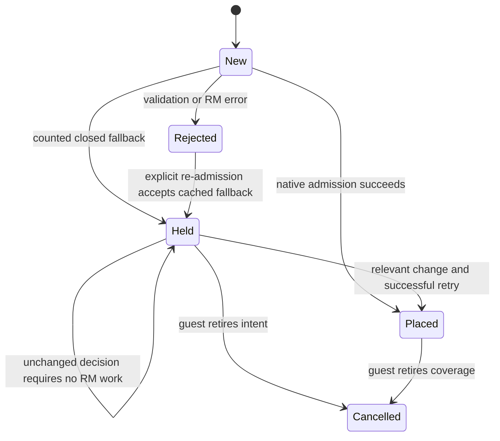

# Saturated sparse admission and reservation lifetime

**STATUS: ENS5 implementation history, 2026-10-27; mechanisms remain live.** Sparse twin stays default OFF. ENS6 supersedes refusal/churn handling and records native RM measurements; ENS7 supersedes the fixed object limits and adds permanent exclusions/current deficit accounting. See `V3_ENS6_RM_COST.md` and `V3_ENS7_SPARSE_BUDGET.md`. The bounds and validation descriptions below describe the ENS5 checkpoint.

## Failure and intervention

CODE READ, `kf-host/src/sparse.rs` at TS1 base `0dbdefd99113c075b1d66c081d82490aa69922d7`: admission cloned the entire reservation tree before checking the request. An error restored wanted bits by visiting every block and up to512 pages per block. Occupied coarse geometry returned `Err(NoMemory)` before setting the decline flag. `kf-mem/src/apply/sparse.rs` turned that error into a failed ACK; the walker consequently emitted the same difference again. A512-page occupancy mask covered only the first2MiB of a much larger coarse reservation, so a later refinement could release a reservation with a live mapping beyond the mask.

MEASURED in the ENS5 CPU run 2026-10-26, `traces/ens5_20261018/timings.json`: valid failing-first tests reproduce the saturated error/decline cost, uncounted occupied fallback, release of far live mappings, and repeated failed sparse ACKs. This isolates a software throughput mechanism consistent with the coordinator's Enscape evidence; it does not prove the Windows timeout has no additional cause. The native RM/guest validation is a separate campaign.

CODE READ, `sparse.rs`, `sparse/state.rs` and `sparse/recycle.rs`: admission now snapshots only intersecting original blocks and restores only their descendants. Oversized requests decline before making an undo snapshot. `mark` and `retire` use predecessor-to-end range queries. Refresh retry visits dirty intent blocks and a fixed-budget cache of changed pending requests; it does not rescan the tree on every walk. `admit_blocks` reports the actual local undo work. Clone/restore phase counters report actual copied blocks/visited pages.

Occupied and budget-constrained admissions return counted `Ok(false)`: sparse coverage remains invalid, no unrelated backing is installed, and the memory apply commits a HELD ACK. Validation, genuine RM and failed-repair errors remain named hard errors. Successful native map/refinement semantics and sparse defaults are unchanged.

## Occupancy, rollback and bounded state

CODE READ, `Live::mark`: occupancy uses merged absolute intervals over the whole reservation, rather than a bitmap for its first2MiB. Each block holds at most512 intervals. Tracking overflow pins the block conservatively until a whole-block unmap; it never makes a possibly live block appear empty. `occupancy_capped` exposes that fallback. A false-positive pin can reduce sparse fidelity; it cannot release another mapping. Typical contiguous maps require one interval. Reserved interval storage is below65MiB per space or257MiB over32768 session blocks, excluding bounded transaction/container overhead; no allocation scales with the guest's virtual-address ceiling.

CODE READ, `channel.rs::map_tree`: the actual HostRm map path captures prior occupancy after preparing geometry and marks provisional occupancy before native placement. A known complete rollback restores the prior occupancy. An explicit `NoMemory` or permission refusal proves the failed native verb installed nothing. Cancellation, transport/decode failure, unknown statuses, misplaced-map cleanup, or a refused rollback retain every possibly live piece. This conservative pin can reduce sparse fidelity until a successful unmap, but never makes uncertain native state releasable. Existing mappings covered by a failed replacement remain pinned. The native-verb fake executes the same helper, including partial failures and rollback refusals.

CODE READ, `Cache`: at most256 negative entries and256 range-change events are retained per space. Entries identify `(VA,length)`, original block extents, epoch and capacity state. Relevant changes invalidate a decision; losing change history invalidates conservatively. Capacity recovery invalidates decisions without deleting accepted intent. Canceling sparse coverage subtracts that range from cached intent, preserving an uncanceled prefix/suffix. Cache overflow is counted; it never grows with guest demand. Normal-block wanted masks remain authoritative when their cache entries are evicted.

An error is not accepted intent. The breaker found that automatically retrying an earlier hard error could create sparse coverage for a run the walker had never committed. The cache therefore distinguishes a remembered error from accepted HELD intent. Only an explicit later admission can accept the former. A later map or unrelated retry cannot accept it on the guest's behalf.

## Recovering the object budget

CODE READ, `recycle.rs`: an ordered candidate index identifies adjacent normal blocks with no live mapping and no wanted bits. Under budget pressure, a call merges at most four pairs. It releases two empty normal reservations and reserves their union as one normal object. A failure restores the originals or poisons placement if repair cannot restore them. There is no tree-wide search for a candidate. The budget consequently recovers after empty-map churn instead of permanently measuring the address span ever touched.

Unchanged sparse coverage and occupied blocks are excluded. Merging active sparse reservations by freeing them would temporarily fault unchanged sparse VAs, contrary to the v3 refresh contract. This change coalesces empty normal geometry, including geometry left after sparse withdrawal; larger active sparse objects remain a design option requiring a safe transition primitive. It introduces no GPU pause or unmap/remap of unchanged backed mappings.

CODE READ, `with_placement`: the existing placement write lock still excludes native allocations/controls while geometry is replaced or repaired. Hot CPU work is local and recycling has a fixed operation budget. An individual native RM ioctl has no software wall-time guarantee. The threaded actor tests check the actual lock helper, including error release; they do not emulate RM/GSP interrupt timing. Existing and extended concurrent batch tests keep physical objects pinned through an in-flight or refused invalidate.

## Same-refresh sparse reconsideration

CODE READ, `apply_entry` and `MapTarget::end_refresh`: after backed unmaps and maps, accepted intent is reconsidered before the final invalidate. The actual GPU target calls `retry_sparse`, and the wrapping target forwards the hook. This removes the need for a second walk when a formerly occupied normal block becomes eligible during this apply. A budget/RM decline can still leave the documented invalid fallback. A retry error cannot fabricate a settled invalidate.

During the refresh a changed VA may resolve to its old mapping, its new state, or a fault. Unchanged mappings remain protected. The vidmem/DMA integration tests drive the actual reservation model through the actual memory apply and check the state at the final invalidate.

## Diagnostics after early print budgets fill

CODE READ, `recent.rs`, `vahist.rs`, `vasmgr.rs` and `device.rs`: refusal, unsettled, sparse-retry and automatic VA-history diagnostics preserve four initial records and twelve recent records. Full automatic VA-history captures remain in a bounded ring after their immediate print budget fills. Text retention is bounded; no debugger or GPU read is required. Existing print limits remain separate from capture retention.

Default-on counters include admission calls, hard errors, declines, cumulative/maximum admission time, local undo blocks, cache hits/evictions, occupancy-cap events, current/peak blocks, apply maximum and walks per heartbeat. RM/invalidate timing uses two host clock reads per ioctl; admission reuses its caller's existing clock. Clone/restore detail remains opt-in.

A slow apply is at least200ms. The first one emits a bounded snapshot once; the count continues increasing. The largest observed pipeline timer is labeled admit, host RM, walk or invalidate (or unattributed when no timer is available). These intervals can overlap and are never added to manufacture a duration. Per-space heartbeat census output keeps the busiest128 spaces and reports total/contended coverage.

Session cumulative `made-freed` is not a current-live gauge: initial roots and final space teardown are not symmetric in those event counters. Use the current object gauge and per-space census. The old retained session deltas cannot justify a new per-space quota.

## Breaker fixtures and scope of evidence

The independent `claude/twin-breaker-20261026` tests were merged, not reimplemented. Four bodies remain intact with explicit ignore reasons:

- Two timing fixtures require the obsolete occupied-admission `Err` precondition; the binding ENS5 behavior is counted `Ok(false)`. New failure/decline timing, scaling and deterministic local-work checks cover the replacement behavior.
- One host fixture calls bookkeeping-only `mark` without RM operations and expects sparse reservation work to happen spontaneously. Actual memory-apply tests now check reconsideration before the same apply's invalidate.
- One memory fixture repeatedly invokes a stateless apply function on an always-refusing fake, bypassing both the lifetime-owned host cache and walker ACKs. Actual host-model/apply/ACK tests cover repeated refreshes without introducing a global cache keyed by reused object pointers.

No breaker assertion body was weakened or deleted. The active strict/lenient adversarial model campaigns cover ownership, failed admission, rollback and budget behavior. The ENS4 relay adversary is reused for gate holds, migration and CreditWait. Model success means no reproduction in that model, not proof about unmodeled RM/GSP or guest-driver behavior.

The source, test/mutation evidence, timing interpretation, retained-log coverage and prospective hardware matrix are recorded in [the ENS5 evidence](../../traces/ens5_20261018/README.md).
