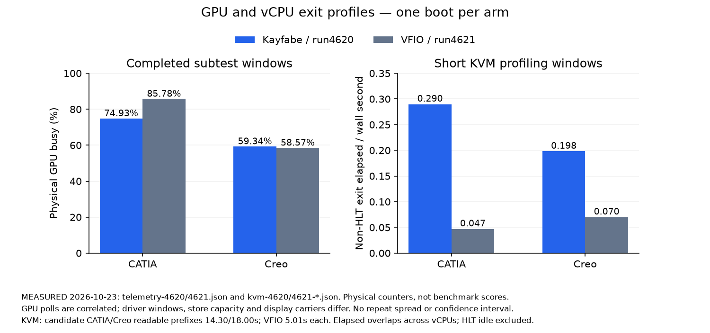

# Q4 K3 perf investigation

STATUS: K3 ANSWERED WITH LIMITS; HOST YIELDED, 2026-10-23. Candidate correctness remains PARTIAL/HOLD.

MEASURED runs4620/4621: paired diagnostic CATIA/Creo arms each completed once on
candidate01a171e63 and physical VFIO, with no reset observer failure. See
[run4620](run-4620.json), [run4621](run-4621.json), and the
[stamped research comparison](profile-comparison-nc.md). These are profiling arms.

MEASURED 2026-10-23, telemetry-4620.json / telemetry-4621.json: CATIA GPU busy averaged74.93% through kayfabe
and85.78% through VFIO; Creo averaged59.34% and58.57%. See
[4620 telemetry](telemetry-4620.json) and [4621 telemetry](telemetry-4621.json).
INFERRED from runs4620/4621: H1 is supported for CATIA but its stated falsifier
is met for Creo; a universal starvation explanation is insufficient. Driver
sampling windows, store capacities and display carriers differ; one boot per arm.

MEASURED 2026-10-23, kvm-4620-catia.json / kvm-4620-creo.json: non-HLT exit elapsed was0.290 and0.198 core-equivalents
in short CATIA/Creo prefixes; run4621 gave0.047 and0.070. See the KVM JSON files.
HLT idle waits are excluded. Exit elapsed is not serial critical-path time.
The original perf-kvm record wrapper aborted at its byte limit in run4620;
those files are explicitly partial. Later plain tracepoint captures closed cleanly.

CODE READ at70f7fb591: the optional direct instrument timestamps before trap
publication and after the actual native doorbell returns; it preserves native
results and has no product decision role. First pending kick to next native
completion is not one-to-one pushbuffer causality or worker dispatch time alone.
MEASURED 2026-10-23, controls/software-controls.json and tests-k3.json:19 focused tests passed,
1097 broader executions passed with4 existing ignores, five mutants killed by
at least two assertions each, clippy added0. See [test proof](tests-k3.json).

MEASURED 2026-10-23, run4622 and linux-profile.json: direct histograms and CPU
stacks are complete; Windows Passthrough was zero and a separate Linux positive
control exercised one real native Passthrough call. See [analysis](analysis.md)
for hypothesis outcomes, attribution limits and one proposed optimization.
[The original falsifiers](plan.json) precede all runs. No optimization is claimed.

MEASURED 2026-10-23, runs4620/4621: physical GPU and non-HLT exit counters
are summarized below. One boot per arm; the detailed JSON and sampling limits
remain authoritative.

## Review follow-ups on candidate714ec29d3

MEASURED 2026-10-23, [ce714-ci-final.json](ce714-ci-final.json): exact
714ec29d3 passed all five hosted CI jobs, including stable and slow. The supplied
[native --ce-seed-only oracle](ce714-native.json) passed once with host-derived
ce_seed=0xc7b5, seeded_launches=1, a correct engine-written semaphore and resource
release, with zero NoCeObject/ForeignClass and zero new Xid. This is a native
kernel-model ring, not a VMM channel-birth test.

MEASURED 2026-10-23, [Linux guest-RAM copy](ce714-linux-guest-ram.json) and
[Linux copy](ce714-linux-ce-client.json): both thin-guest copy arms passed and
completed real forwarded work. Their KERNEL BORN lines carry ce_seed=0xc7b5,
but every corresponding seeded_launches counter stayed0. The UVM-only probe's
original strict copy-witness assertion failure is retained in
[ce714-linux-uvm-control.json](ce714-linux-uvm-control.json); it is excluded from
copy coverage, and its gate was not weakened or rerun.

MEASURED 2026-10-23, [Energy four-boot series](ce714-energy-four.json): all four
fresh production-configuration boots, runs4630–4633, completed with zero153/4101,
reboots, Budget/poison, class refusals or new Xid. Each restored cleanly. Each
boot had six KERNEL copy lifetimes with host-derived ce_seed=0xc7b5; all had
seeded_launches=0. The predeclared prediction of a positive missing-bind witness
in these Energy trials met its falsifier. Workload completion is positive
regression coverage, not proof of the VMM missing-bind mechanism. The native
positive remains separate. See each run's JSON and lifecycle correlation.

MEASURED 2026-10-23, [matched master cursor](master10-cursor-comparison.json):
master e9c6d39e5 reproduces the original RGB oracle failures48/52, with matching
254/281-pixel shapes. The saved guest and host pixel maps are individually
identical to the earlier candidate01a captures after hotspot alignment. The
same oracle, tolerance2 and hook hashes were used; physical pointer placement
was corrected first. A host-only Xcursor control preserved every RGBA byte.
INFERRED from master10-cursor-comparison.json: this discrepancy predates6d;
its responsible component remains unlocalized. The RGB oracle still fails.
Earlier invalid master7/8/9 attempts are preserved and excluded.

CODE READ controller ruling2026-10-23: RowsLog remains research only, with no
implementation before the longer CATIA falsifier. No production optimization
was made. The full native/Linux suites and all application smokes were not
rerun on714ec29d3; candidate correctness remains PARTIAL/HOLD, including the
independent review's M3 lockstep question. This lane does not decide a merge.

MEASURED 2026-10-23, [host-yield.json](host-yield.json): host yielded at
06:49:51UTC, ahead of the four-hour deadline07:40:08UTC. The final
[restore receipt](k3-host-return.json) confirms NVIDIA bound, fresh cuInit0,
GDM active, Ubuntu logged in, autologin configured and two monitors. Own
workers are absent, dedicated Cargo targets removed, fastguest lock released
and quiet flag absent. No GPU/VM work follows yield until the controller
explicitly returns the host. [Final summary](final-summary.json).
